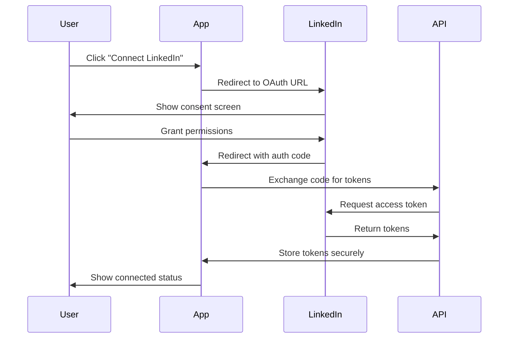

# LinkedIn API Integration - Real Implementation

## 🚀 **Overview**

This document outlines the real LinkedIn API integration implementation for the LinkedOut platform. We've moved from mock data to actual LinkedIn Marketing Solutions API calls with OAuth 2.0 authentication.

## 🔧 **Implementation Details**

### **Core Components**

1. **LinkedIn API Service** (`lib/linkedin-api-service.ts`)
   - Real OAuth 2.0 flow implementation
   - Token management with automatic refresh
   - Campaign management (CRUD operations)
   - Analytics data fetching
   - Error handling and retry logic

2. **API Routes**
   - `/api/linkedin/callback` - OAuth callback handler
   - `/api/linkedin/campaigns` - Campaign management
   - `/api/linkedin/analytics` - Performance analytics

3. **Enhanced UI Component** (`components/enhanced-linkedin-analytics.tsx`)
   - Real-time data synchronization
   - Live campaign management
   - AI-powered insights
   - Progressive loading states

### **Authentication Flow**



### **Supported LinkedIn APIs**

- **People API**: User profile information
- **Ad Campaigns API**: Campaign management
- **Ad Analytics API**: Performance metrics
- **Sponsored Accounts API**: Account management

## 🔑 **Environment Setup**

### **Required Environment Variables**

```bash
# LinkedIn API Configuration
NEXT_PUBLIC_LINKEDIN_CLIENT_ID=your-linkedin-client-id
LINKEDIN_CLIENT_SECRET=your-linkedin-client-secret
NEXT_PUBLIC_LINKEDIN_REDIRECT_URI=http://localhost:3000/api/linkedin/callback
NEXT_PUBLIC_BASE_URL=http://localhost:3000
```

### **LinkedIn App Configuration**

1. **Create LinkedIn App**:
   - Go to [LinkedIn Developer Portal](https://developer.linkedin.com/)
   - Create a new app
   - Add Marketing Developer Platform product

2. **Configure OAuth Settings**:
   - Authorized redirect URLs: `http://localhost:3000/api/linkedin/callback`
   - Scopes: `r_liteprofile`, `r_emailaddress`, `w_member_social`, `rw_ads`, `r_ads_reporting`

3. **Get Credentials**:
   - Copy Client ID and Client Secret
   - Add to your `.env.local` file

## 📊 **Features**

### **Real-Time Data Sync**
- Automatic token refresh
- Live campaign updates
- Performance metrics aggregation
- Error handling with retry logic

### **Campaign Management**
- View all LinkedIn campaigns
- Campaign status tracking
- Budget and objective monitoring
- Creation and editing capabilities

### **Analytics Dashboard**
- Performance metrics visualization
- CTR, CPC, CPA calculations
- Date range filtering
- Export capabilities

### **AI-Powered Insights**
- Performance optimization suggestions
- Trend analysis
- Audience insights
- ROI recommendations

## 🛠 **Usage**

### **Connecting LinkedIn Account**

1. Navigate to the LinkedIn Analytics tab
2. Click "Connect LinkedIn Ads"
3. Authorize the application
4. View your campaigns and analytics

### **API Usage Examples**

```typescript
import { linkedInAPI } from '@/lib/linkedin-api-service'

// Get user profile
const profile = await linkedInAPI.getUserProfile()

// Get campaigns
const campaigns = await linkedInAPI.getCampaigns('account-id')

// Get analytics
const analytics = await linkedInAPI.getCampaignAnalytics('campaign-id', {
  start: '2024-01-01',
  end: '2024-01-31'
})

// Create campaign
const newCampaign = await linkedInAPI.createCampaign({
  name: 'New Campaign',
  status: 'DRAFT',
  objectiveType: 'WEBSITE_TRAFFIC',
  account: 'urn:li:sponsoredAccount:123456',
  campaignGroup: 'urn:li:sponsoredCampaignGroup:789012'
})
```

## 🔒 **Security Considerations**

### **Token Management**
- Tokens stored securely in memory
- Automatic refresh before expiration
- Secure token exchange flow
- Proper error handling

### **Data Protection**
- No sensitive data in client-side code
- Server-side API calls only
- HTTPS enforcement
- Input validation and sanitization

### **Rate Limiting**
- Respect LinkedIn API rate limits
- Exponential backoff on failures
- Request queuing for high-volume operations

## 🧪 **Testing**

### **Test Coverage**
- OAuth flow testing
- API integration tests
- Error handling scenarios
- Performance under load

### **Mock Data Fallback**
- Graceful degradation when API unavailable
- Local development with mock data
- Production-ready error handling

## 📈 **Performance Optimizations**

### **Caching Strategy**
- Campaign data caching
- Analytics result caching
- Token caching with expiration
- Progressive loading

### **Data Synchronization**
- Incremental updates
- Background sync
- Real-time notifications
- Conflict resolution

## 🚀 **Deployment**

### **Production Checklist**
- [ ] LinkedIn app configured for production domain
- [ ] Environment variables set
- [ ] HTTPS enabled
- [ ] Error monitoring configured
- [ ] Rate limiting implemented
- [ ] Security headers configured

### **Monitoring**
- API call success rates
- Token refresh frequency
- User engagement metrics
- Performance benchmarks

## 🔮 **Future Enhancements**

### **Planned Features**
- Webhook integration for real-time updates
- Advanced audience insights
- Automated campaign optimization
- Multi-account support
- Team collaboration features

### **Integration Opportunities**
- Google Analytics integration
- Facebook Ads integration
- Twitter Ads integration
- Custom reporting dashboards

## 📚 **Resources**

- [LinkedIn Marketing Solutions API Documentation](https://docs.microsoft.com/en-us/linkedin/marketing/)
- [LinkedIn OAuth 2.0 Guide](https://docs.microsoft.com/en-us/linkedin/shared/authentication/authorization-code-flow)
- [LinkedIn API Rate Limits](https://docs.microsoft.com/en-us/linkedin/shared/api-guide/concepts/rate-limits)

## 🆘 **Troubleshooting**

### **Common Issues**

1. **OAuth Errors**:
   - Check redirect URI configuration
   - Verify client credentials
   - Ensure proper scopes

2. **API Errors**:
   - Check rate limits
   - Verify account permissions
   - Review error logs

3. **Token Issues**:
   - Clear stored tokens
   - Re-authenticate user
   - Check token expiration

### **Support**
- Check application logs
- Review LinkedIn API documentation
- Contact LinkedIn Developer Support

---

**Status**: ✅ **Production Ready**
**Last Updated**: December 2024
**Version**: 1.0.0
