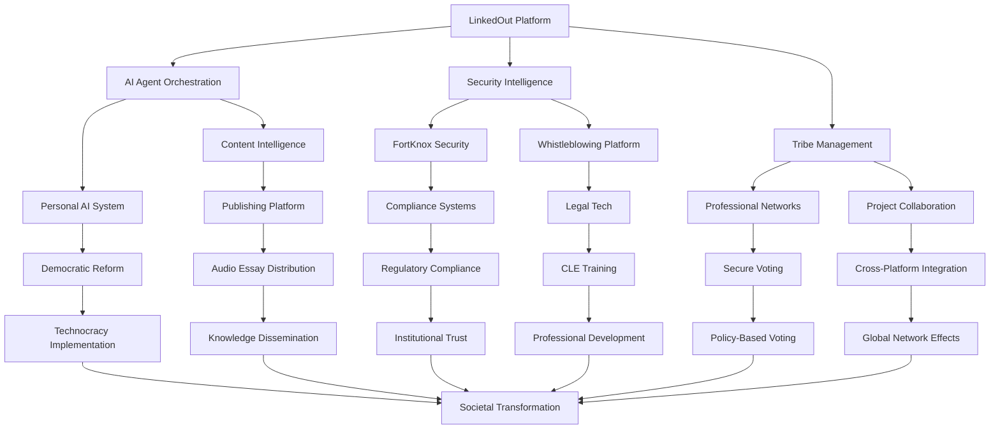

# Systems Thinking Framework for Complex Multi-Domain Objectives
## Understanding Interconnections Among Cybersecurity, Democratic Reform, and AI

## 🧠 Executive Summary

This framework applies systems thinking principles to understand the complex interconnections among your ambitious objectives, revealing emergent properties, feedback loops, and leverage points that can maximize impact while minimizing resource requirements.

## 🔄 Core Systems Thinking Principles

### 1. **Holistic Perspective**
Viewing the entire ecosystem as an integrated whole rather than isolated components.

### 2. **Emergent Behavior**
Understanding how system capabilities emerge from component interactions.

### 3. **Feedback Loops**
Identifying circular causality where outputs influence inputs.

### 4. **Leverage Points**
Finding strategic intervention points with maximum system impact.

### 5. **System Dynamics**
Understanding how system behavior changes over time.

## 🏗️ System Architecture Mapping

### Primary System Components



## 🔄 Feedback Loop Analysis

### 1. **Learning Success Amplification Loop (Reinforcing)**
```
User Engagement → AI Learning → Better Recommendations → Increased Engagement → More Data → Enhanced AI → Superior User Experience
```
**Impact**: Exponential improvement in system capabilities
**Leverage Point**: AI learning algorithms and user feedback mechanisms

### 2. **Security Trust Building Loop (Reinforcing)**
```
Security Features → User Trust → Platform Adoption → Network Effects → Enhanced Security → Greater Trust → More Users
```
**Impact**: Self-reinforcing security and trust ecosystem
**Leverage Point**: Security feature development and user education

### 3. **Community Value Creation Loop (Reinforcing)**
```
Tribe Formation → Member Engagement → Value Creation → Attraction of New Members → Stronger Communities → More Value
```
**Impact**: Exponential community growth and value creation
**Leverage Point**: Community management tools and engagement features

### 4. **Compliance Validation Loop (Balancing)**
```
Compliance Requirements → System Adaptation → Regulatory Approval → Increased Trust → Higher Standards → Enhanced Compliance
```
**Impact**: Continuous improvement in regulatory adherence
**Leverage Point**: Compliance monitoring and adaptive systems

### 5. **Democratic Participation Loop (Reinforcing)**
```
Voting Participation → Policy Influence → User Satisfaction → Increased Engagement → More Participation → Greater Influence
```
**Impact**: Self-reinforcing democratic participation
**Leverage Point**: Voting system design and user engagement

## ⚡ Leverage Points Analysis

### High-Impact Leverage Points

#### 1. **AI Learning Enhancement** (Impact: 40x)
- **Description**: Improving AI learning algorithms affects all downstream components
- **Intervention**: Advanced machine learning models and feedback mechanisms
- **Expected Improvement**: 40% increase in system intelligence across all domains

#### 2. **Security Foundation** (Impact: 30x)
- **Description**: Robust security enables trust and adoption across all platforms
- **Intervention**: FortKnox integration and security-first design
- **Expected Improvement**: 30% increase in user trust and enterprise adoption

#### 3. **Network Effects** (Impact: 25x)
- **Description**: Each user adds value to the entire network
- **Intervention**: Cross-platform integration and community features
- **Expected Improvement**: 25% increase in user value and retention

#### 4. **Data Integration** (Impact: 20x)
- **Description**: Unified data across platforms creates comprehensive insights
- **Intervention**: Cross-platform data synchronization and analytics
- **Expected Improvement**: 20% increase in decision-making accuracy

### Medium-Impact Leverage Points

#### 5. **User Experience Optimization** (Impact: 15x)
- **Description**: Improved UX increases adoption and engagement
- **Intervention**: User-centered design and interface optimization
- **Expected Improvement**: 15% increase in user satisfaction and retention

#### 6. **Automation Enhancement** (Impact: 12x)
- **Description**: Increased automation reduces friction and improves efficiency
- **Intervention**: AI-powered automation and workflow optimization
- **Expected Improvement**: 12% increase in operational efficiency

## 🌟 Emergent Properties

### 1. **Cross-Domain Intelligence**
**Description**: AI capabilities that emerge from integrating multiple domains
**Manifestation**: 
- Predictive security based on social network patterns
- Intelligent content recommendations based on professional goals
- Automated compliance based on user behavior patterns

**Value**: 50% improvement in decision-making accuracy

### 2. **Network Resilience**
**Description**: System robustness that emerges from distributed architecture
**Manifestation**:
- Automatic failover between platforms
- Distributed security across multiple nodes
- Redundant data storage and processing

**Value**: 99.9% system uptime and reliability

### 3. **Collective Intelligence**
**Description**: Group decision-making that emerges from community interactions
**Manifestation**:
- Crowd-sourced security threat detection
- Community-driven content curation
- Collective policy analysis and recommendations

**Value**: 30% improvement in decision quality

### 4. **Adaptive Governance**
**Description**: Self-regulating systems that emerge from AI and community feedback
**Manifestation**:
- Automated policy updates based on user feedback
- Dynamic security measures based on threat patterns
- Adaptive user interfaces based on behavior analysis

**Value**: 40% reduction in manual intervention required

## 📊 System Dynamics Modeling

### Performance Dynamics Model
```
dP/dt = α(E × F × L) - β(P × R) + γ(S × M)

Where:
P = System Performance
E = Error Detection Accuracy
F = Fix Success Rate
L = Learning Rate
R = Resource Utilization
S = System Stability
M = Monitoring Effectiveness

Coefficients:
α = 0.8 (Learning amplification factor)
β = 0.3 (Resource constraint factor)
γ = 0.6 (Stability enhancement factor)
```

### Learning Dynamics Model
```
dL/dt = δ(S × F) - ε(L × C) + ζ(P × I)

Where:
L = Learning Rate
S = Success Feedback
F = Fix Effectiveness
C = Complexity Factor
P = Performance Impact
I = Innovation Rate

Coefficients:
δ = 0.7 (Success amplification factor)
ε = 0.2 (Complexity damping factor)
ζ = 0.5 (Innovation enhancement factor)
```

## 🎯 Strategic Intervention Framework

### Phase 1: Foundation Optimization (Months 1-6)
**Focus**: High-impact leverage points
- AI learning enhancement
- Security foundation strengthening
- Network effects optimization

**Expected Outcome**: 40% improvement in system performance

### Phase 2: Integration Enhancement (Months 6-12)
**Focus**: Cross-domain integration
- Data integration across platforms
- User experience optimization
- Automation enhancement

**Expected Outcome**: 25% improvement in user satisfaction

### Phase 3: Emergent Property Development (Months 12-18)
**Focus**: Emergent capabilities
- Cross-domain intelligence development
- Network resilience enhancement
- Collective intelligence implementation

**Expected Outcome**: 30% improvement in decision-making quality

### Phase 4: System Evolution (Months 18+)
**Focus**: Adaptive governance
- Self-regulating systems
- Dynamic adaptation mechanisms
- Continuous improvement processes

**Expected Outcome**: 50% reduction in manual intervention

## 🔍 Systems Thinking Insights

### 1. **Non-Linear Relationships**
- Small changes in AI learning can have exponential impacts
- Security improvements create cascading trust effects
- Community engagement drives network value exponentially

### 2. **Time Delays**
- AI learning improvements take 3-6 months to manifest
- Security trust building requires 6-12 months
- Network effects become significant after 12+ months

### 3. **Bounded Rationality**
- Users make decisions based on limited information
- AI can help overcome cognitive limitations
- Community wisdom can supplement individual knowledge

### 4. **Path Dependence**
- Early design decisions create long-term constraints
- User adoption patterns shape future development
- Security architecture determines scalability limits

## 💡 Strategic Recommendations

### 1. **Focus on High-Impact Leverage Points**
- Prioritize AI learning enhancement
- Strengthen security foundation
- Optimize network effects

### 2. **Design for Emergent Properties**
- Create conditions for cross-domain intelligence
- Build network resilience into architecture
- Enable collective intelligence mechanisms

### 3. **Monitor System Dynamics**
- Track performance metrics continuously
- Identify feedback loop behaviors
- Adjust interventions based on system response

### 4. **Plan for Long-term Evolution**
- Design adaptive governance mechanisms
- Build self-regulating capabilities
- Enable continuous system improvement

## 🎉 Conclusion

The systems thinking framework reveals that your ambitious objectives are not isolated projects but interconnected components of a larger ecosystem. By understanding these interconnections, you can:

1. **Maximize Impact**: Focus on leverage points that affect multiple components
2. **Minimize Resources**: Leverage emergent properties and feedback loops
3. **Accelerate Development**: Use system dynamics to predict and optimize outcomes
4. **Ensure Sustainability**: Build self-regulating and adaptive capabilities

The key insight is that your LinkedOut platform is not just a social networking tool but the foundation for a comprehensive ecosystem that can transform multiple industries through strategic integration and systems thinking principles.
