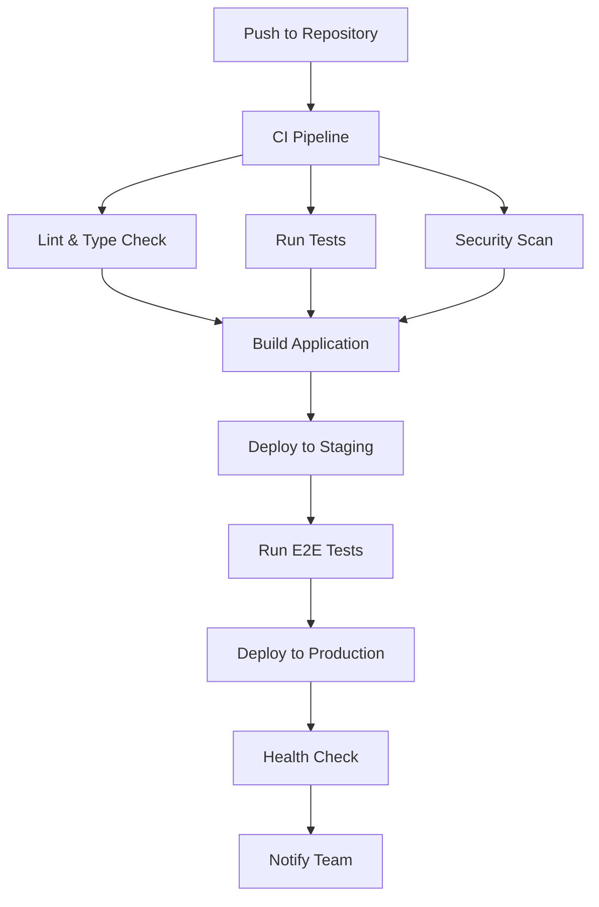

# AgentDash Deployment Guide

This guide covers the complete deployment process for AgentDash, including CI/CD pipeline setup, environment configuration, and deployment strategies.

## 🚀 Quick Start

### Prerequisites

- GitHub repository with CI/CD workflows
- Vercel account for hosting
- Docker Hub account for container registry
- Required API credentials (LinkedIn, Office 365)

### 1. Repository Setup

```bash
# Clone the repository
git clone https://github.com/reconsumeralization/AgentDash.git
cd AgentDash

# Install dependencies
npm install

# Set up environment variables
cp .env.example .env.local
# Edit .env.local with your configuration
```

### 2. Secrets Configuration

Run the automated secrets setup script:

```bash
# Make script executable (Linux/Mac)
chmod +x .github/workflows/setup-secrets.sh

# Run the setup script
./.github/workflows/setup-secrets.sh
```

Or set up secrets manually using GitHub CLI:

```bash
# Set individual secrets
gh secret set NEXT_PUBLIC_APP_URL --body "https://agentdash.vercel.app"
gh secret set LINKEDIN_CLIENT_ID --body "your-linkedin-client-id"
# ... (see SECRETS_SETUP.md for complete list)
```

### 3. Deploy to Production

```bash
# Push to main branch to trigger production deployment
git add .
git commit -m "feat: initial deployment"
git push origin main
```

## 🏗️ Architecture Overview

### Deployment Environments

| Environment | Branch | URL | Purpose |
|-------------|--------|-----|---------|
| **Development** | `develop` | `http://localhost:3000` | Local development |
| **Staging** | `develop` | `https://staging.agentdash.com` | Testing and QA |
| **Production** | `main` | `https://agentdash.com` | Live application |

### Infrastructure Components

- **Frontend**: Next.js application hosted on Vercel
- **Database**: Supabase PostgreSQL
- **Authentication**: Clerk
- **APIs**: LinkedIn API, Office 365 Management API
- **Monitoring**: Vercel Analytics, Sentry
- **CDN**: Vercel Edge Network

## 🔧 CI/CD Pipeline

### Workflow Overview



### Pipeline Stages

#### 1. **Lint & Type Check**
- ESLint code quality checks
- TypeScript type checking
- Prettier code formatting
- **Duration**: ~2 minutes

#### 2. **Test Suite**
- Unit tests (Jest)
- Integration tests
- API tests
- Coverage reporting
- **Duration**: ~5 minutes

#### 3. **Security Scan**
- Dependency vulnerability scan
- Code security analysis
- Container security scan
- Secrets detection
- **Duration**: ~3 minutes

#### 4. **Build**
- Next.js production build
- Static asset optimization
- Docker image build
- **Duration**: ~4 minutes

#### 5. **Deploy**
- Staging deployment (develop branch)
- Production deployment (main branch)
- Health checks
- **Duration**: ~3 minutes

## 🌐 Deployment Strategies

### 1. **Blue-Green Deployment**

```yaml
# Vercel handles blue-green deployment automatically
# Zero-downtime deployments with instant rollback capability
```

### 2. **Canary Deployment**

```yaml
# Gradual rollout to percentage of users
# Automatic rollback on error rate increase
```

### 3. **Feature Flags**

```typescript
// Use feature flags for gradual feature rollouts
const isNewFeatureEnabled = process.env.NEXT_PUBLIC_FEATURE_FLAG === 'true'
```

## 🔐 Environment Configuration

### Development Environment

```bash
# .env.local
NODE_ENV=development
NEXT_PUBLIC_APP_URL=http://localhost:3000
DATABASE_URL=postgresql://localhost:5432/agentdash_dev
LINKEDIN_CLIENT_ID=your-dev-client-id
LINKEDIN_CLIENT_SECRET=your-dev-client-secret
```

### Staging Environment

```bash
# Vercel Environment Variables
NODE_ENV=staging
NEXT_PUBLIC_APP_URL=https://staging.agentdash.com
DATABASE_URL=postgresql://staging-db-url
LINKEDIN_CLIENT_ID=your-staging-client-id
LINKEDIN_CLIENT_SECRET=your-staging-client-secret
```

### Production Environment

```bash
# Vercel Environment Variables
NODE_ENV=production
NEXT_PUBLIC_APP_URL=https://agentdash.com
DATABASE_URL=postgresql://production-db-url
LINKEDIN_CLIENT_ID=your-production-client-id
LINKEDIN_CLIENT_SECRET=your-production-client-secret
```

## 🐳 Docker Deployment

### Local Development

```bash
# Start development environment
docker-compose -f docker-compose.dev.yml up

# Access services
# - App: http://localhost:3000
# - Database: localhost:5433
# - Redis: localhost:6380
# - pgAdmin: http://localhost:5050
```

### Production Deployment

```bash
# Build production image
docker build -t agentdash:latest .

# Run production container
docker run -p 3000:3000 \
  -e DATABASE_URL=your-db-url \
  -e LINKEDIN_CLIENT_ID=your-client-id \
  agentdash:latest
```

### Docker Compose Production

```bash
# Start production stack
docker-compose up -d

# Monitor logs
docker-compose logs -f

# Scale services
docker-compose up -d --scale agentdash=3
```

## 📊 Monitoring & Observability

### Health Checks

```typescript
// API health check endpoint
export async function GET() {
  const health = {
    status: 'healthy',
    timestamp: new Date().toISOString(),
    version: process.env.npm_package_version,
    environment: process.env.NODE_ENV
  }
  
  return Response.json(health)
}
```

### Metrics Collection

- **Performance**: Vercel Analytics, Lighthouse CI
- **Errors**: Sentry error tracking
- **Uptime**: Uptime monitoring
- **Logs**: Structured logging with correlation IDs

### Alerting

```yaml
# Slack notifications for:
# - Deployment success/failure
# - High error rates
# - Performance degradation
# - Security incidents
```

## 🔄 Database Migrations

### Development

```bash
# Run migrations locally
npm run db:migrate

# Seed development data
npm run db:seed

# Reset database
npm run db:reset
```

### Production

```yaml
# Automated migrations in CI/CD pipeline
# - Run before deployment
# - Rollback on failure
# - Backup before migration
```

## 🚨 Rollback Procedures

### Automatic Rollback

```yaml
# Vercel automatic rollback on:
# - Health check failures
# - High error rates
# - Performance degradation
```

### Manual Rollback

```bash
# Rollback to previous deployment
vercel rollback

# Rollback to specific version
vercel rollback --to=deployment-url

# Rollback database
npm run db:rollback
```

## 🔍 Troubleshooting

### Common Issues

#### 1. **Build Failures**

```bash
# Check build logs
vercel logs --follow

# Common fixes:
# - Update dependencies
# - Fix TypeScript errors
# - Check environment variables
```

#### 2. **Deployment Failures**

```bash
# Check deployment status
vercel ls

# Common fixes:
# - Verify secrets are set
# - Check API credentials
# - Validate environment variables
```

#### 3. **Database Connection Issues**

```bash
# Test database connection
npm run db:test

# Common fixes:
# - Check DATABASE_URL format
# - Verify network connectivity
# - Check database permissions
```

### Debug Commands

```bash
# Local debugging
npm run dev
npm run test:debug
npm run lighthouse:ci

# Production debugging
vercel logs --follow
docker logs container-name
```

## 📈 Performance Optimization

### Build Optimization

```javascript
// next.config.js
module.exports = {
  output: 'standalone',
  experimental: {
    outputFileTracingRoot: path.join(__dirname, '../../'),
  },
  images: {
    domains: ['images.unsplash.com'],
    formats: ['image/webp', 'image/avif'],
  },
}
```

### Runtime Optimization

```typescript
// Enable caching
export const revalidate = 3600 // 1 hour

// Optimize images
import Image from 'next/image'
<Image
  src="/image.jpg"
  alt="Description"
  width={500}
  height={300}
  priority
/>
```

## 🔒 Security Considerations

### Environment Security

- ✅ Secrets stored in GitHub Secrets
- ✅ Environment variables encrypted
- ✅ No secrets in code repository
- ✅ Regular secret rotation

### Application Security

- ✅ HTTPS enforced
- ✅ CSP headers configured
- ✅ Rate limiting implemented
- ✅ Input validation and sanitization

### Infrastructure Security

- ✅ Container security scanning
- ✅ Dependency vulnerability scanning
- ✅ Code security analysis
- ✅ Secrets detection

## 📚 Additional Resources

- [Vercel Deployment Guide](https://vercel.com/docs/deployments)
- [Next.js Deployment](https://nextjs.org/docs/deployment)
- [Docker Best Practices](https://docs.docker.com/develop/dev-best-practices/)
- [GitHub Actions Documentation](https://docs.github.com/en/actions)

## 🆘 Support

For deployment issues:

1. Check the [GitHub Issues](https://github.com/reconsumeralization/AgentDash/issues)
2. Review the [CI/CD logs](https://github.com/reconsumeralization/AgentDash/actions)
3. Contact the development team
4. Check the [troubleshooting section](#troubleshooting)

---

**Happy Deploying! 🚀**
