# AgentDash Complete System Architecture - Single Graph

## 🎯 Complete System Architecture (One Graph)

Copy and paste this code into [Mermaid Live Editor](https://mermaid.live/):

```mermaid
graph TB
    %% User Interface Layer
    subgraph "🎨 User Interface Layer"
        UI1[Main Dashboard]
        UI2[LinkedIn Command Center]
        UI3[Intelligent News Dashboard]
        UI4[Agent Orchestration Panel]
        UI5[Security Intelligence Center]
        UI6[Code Intelligence Hub]
        UI7[Alert Management System]
    end

    %% API Gateway Layer
    subgraph "🔌 API Gateway Layer"
        API1[LinkedIn Lite Profile API]
        API2[News Synthesis API]
        API3[Alert Management API]
        API4[Agent Management API]
        API5[Security Intelligence API]
        API6[Code Intelligence API]
        API7[Social Media API]
    end

    %% Core Services Layer
    subgraph "⚙️ Core Services Layer"
        subgraph "LinkedIn Integration Services"
            LI1[OAuth 2.0 Authentication]
            LI2[LinkedIn Lite Profile Service]
            LI3[Profile Enhancement Engine]
            LI4[Verification Status Manager]
            LI5[Professional Context Analyzer]
        end
        
        subgraph "Intelligent News Synthesis"
            NS1[Content Collection Engine]
            NS2[Multi-Platform Aggregator]
            NS3[Sentiment Analysis Engine]
            NS4[Trend Detection System]
            NS5[Leading Indicators Generator]
            NS6[Real-time Analytics Engine]
        end
        
        subgraph "Agent Orchestration"
            AO1[Agent Manager]
            AO2[Workflow Engine]
            AO3[Performance Monitor]
            AO4[Custom Agent Builder]
            AO5[Resource Allocator]
            AO6[Event Scheduler]
        end
        
        subgraph "Security Intelligence"
            SI1[Vulnerability Scanner]
            SI2[Threat Detection Engine]
            SI3[Compliance Tracker]
            SI4[Incident Response System]
            SI5[Risk Assessment Engine]
            SI6[Security Analytics]
        end
        
        subgraph "Code Intelligence"
            CI1[Code Analysis Engine]
            CI2[Performance Optimizer]
            CI3[Quality Assessor]
            CI4[Security Scanner]
            CI5[Documentation Generator]
        end
    end

    %% Data Processing Layer
    subgraph "🔄 Data Processing Layer"
        DP1[Data Ingestion Pipeline]
        DP2[Data Validation Engine]
        DP3[Data Transformation Service]
        DP4[Data Enrichment Engine]
        DP5[Real-time Processing Engine]
        DP6[Batch Processing Engine]
    end

    %% Data Storage Layer
    subgraph "💾 Data Storage Layer"
        subgraph "Primary Database"
            DB1[(Supabase PostgreSQL)]
            DB2[(User Profiles)]
            DB3[(Agent Configurations)]
            DB4[(Security Logs)]
        end
        
        subgraph "Cache Layer"
            CACHE1[LinkedIn Profile Cache]
            CACHE2[News Synthesis Cache]
            CACHE3[Alert Cache]
            CACHE4[Performance Cache]
        end
        
        subgraph "Analytics Storage"
            ANALYTICS1[(Analytics Database)]
            ANALYTICS2[(Metrics Storage)]
            ANALYTICS3[(Audit Logs)]
        end
    end

    %% External Services Layer
    subgraph "🌐 External Services Layer"
        EXT1[LinkedIn Lite Profile API]
        EXT2[OpenAI GPT API]
        EXT3[Google Gemini API]
        EXT4[Social Media APIs]
        EXT5[Security Intelligence APIs]
        EXT6[Code Analysis APIs]
    end

    %% Real-time Communication Layer
    subgraph "⚡ Real-time Communication Layer"
        RT1[WebSocket Server]
        RT2[Live Update Engine]
        RT3[Alert Notification System]
        RT4[Performance Monitoring]
        RT5[Event Streaming]
    end

    %% Connections - UI to API
    UI1 --> API1
    UI1 --> API2
    UI1 --> API3
    UI2 --> API1
    UI2 --> API7
    UI3 --> API2
    UI3 --> API3
    UI4 --> API4
    UI5 --> API5
    UI6 --> API6
    UI7 --> API3

    %% Connections - API to Core Services
    API1 --> LI1
    API1 --> LI2
    API2 --> NS1
    API2 --> NS2
    API3 --> NS5
    API3 --> RT3
    API4 --> AO1
    API5 --> SI1
    API6 --> CI1
    API7 --> NS1

    %% Connections - Core Services Internal
    LI1 --> LI2
    LI2 --> LI3
    LI3 --> LI4
    LI4 --> LI5
    
    NS1 --> NS2
    NS2 --> NS3
    NS3 --> NS4
    NS4 --> NS5
    NS5 --> NS6
    
    AO1 --> AO2
    AO2 --> AO3
    AO3 --> AO4
    AO4 --> AO5
    AO5 --> AO6
    
    SI1 --> SI2
    SI2 --> SI3
    SI3 --> SI4
    SI4 --> SI5
    SI5 --> SI6
    
    CI1 --> CI2
    CI2 --> CI3
    CI3 --> CI4
    CI4 --> CI5

    %% Connections - Core Services to Data Processing
    LI3 --> DP1
    NS2 --> DP1
    AO1 --> DP1
    SI1 --> DP1
    CI1 --> DP1

    DP1 --> DP2
    DP2 --> DP3
    DP3 --> DP4
    DP4 --> DP5
    DP4 --> DP6

    %% Connections - Data Processing to Storage
    DP5 --> DB1
    DP5 --> CACHE1
    DP5 --> CACHE2
    DP6 --> ANALYTICS1
    DP6 --> ANALYTICS2

    %% Connections - Core Services to External APIs
    LI1 --> EXT1
    LI2 --> EXT1
    NS1 --> EXT4
    SI1 --> EXT5
    CI1 --> EXT6
    AO1 --> EXT2
    AO1 --> EXT3

    %% Connections - Real-time Layer
    RT1 --> UI1
    RT1 --> UI3
    RT1 --> UI7
    RT2 --> NS6
    RT3 --> NS5
    RT4 --> AO3
    RT5 --> DP5

    %% Connections - Storage to Real-time
    CACHE1 --> RT2
    CACHE2 --> RT2
    CACHE3 --> RT3
    CACHE4 --> RT4

    %% Styling
    classDef uiClass fill:#e1f5fe,stroke:#01579b,stroke-width:2px,color:#000
    classDef apiClass fill:#f3e5f5,stroke:#4a148c,stroke-width:2px,color:#000
    classDef serviceClass fill:#e8f5e8,stroke:#1b5e20,stroke-width:2px,color:#000
    classDef dataClass fill:#fff3e0,stroke:#e65100,stroke-width:2px,color:#000
    classDef externalClass fill:#fce4ec,stroke:#880e4f,stroke-width:2px,color:#000
    classDef realtimeClass fill:#f1f8e9,stroke:#33691e,stroke-width:2px,color:#000
    classDef processingClass fill:#e0f2f1,stroke:#004d40,stroke-width:2px,color:#000

    class UI1,UI2,UI3,UI4,UI5,UI6,UI7 uiClass
    class API1,API2,API3,API4,API5,API6,API7 apiClass
    class LI1,LI2,LI3,LI4,LI5,NS1,NS2,NS3,NS4,NS5,NS6,AO1,AO2,AO3,AO4,AO5,AO6,SI1,SI2,SI3,SI4,SI5,SI6,CI1,CI2,CI3,CI4,CI5 serviceClass
    class DB1,DB2,DB3,DB4,CACHE1,CACHE2,CACHE3,CACHE4,ANALYTICS1,ANALYTICS2,ANALYTICS3 dataClass
    class EXT1,EXT2,EXT3,EXT4,EXT5,EXT6 externalClass
    class RT1,RT2,RT3,RT4,RT5 realtimeClass
    class DP1,DP2,DP3,DP4,DP5,DP6 processingClass
```

## 🎯 Key Features Visualized

### 🎨 **User Interface Layer**
- Main Dashboard with system overview
- LinkedIn Command Center for professional networking
- Intelligent News Dashboard with real-time indicators
- Agent Orchestration Panel for AI agent management
- Security Intelligence Center for threat monitoring
- Code Intelligence Hub for development tools
- Alert Management System for notifications

### 🔌 **API Gateway Layer**
- LinkedIn Lite Profile API for verified profile data
- News Synthesis API for content aggregation
- Alert Management API for real-time notifications
- Agent Management API for AI agent operations
- Security Intelligence API for threat detection
- Code Intelligence API for development assistance
- Social Media API for multi-platform integration

### ⚙️ **Core Services Layer**
- **LinkedIn Integration**: OAuth, profile enhancement, verification
- **News Synthesis**: Content collection, sentiment analysis, leading indicators
- **Agent Orchestration**: Agent management, workflows, performance monitoring
- **Security Intelligence**: Vulnerability scanning, threat detection, compliance
- **Code Intelligence**: Code analysis, optimization, quality assessment

### 🔄 **Data Processing Layer**
- Real-time and batch processing pipelines
- Data validation, transformation, and enrichment
- Multi-source data aggregation and analysis

### 💾 **Data Storage Layer**
- Primary PostgreSQL database with Supabase
- Multi-layer caching for performance
- Analytics and audit storage systems

### 🌐 **External Services Layer**
- LinkedIn Lite Profile API integration
- OpenAI GPT and Google Gemini AI services
- Social media and security intelligence APIs

### ⚡ **Real-time Communication Layer**
- WebSocket connections for live updates
- Real-time alert notifications
- Performance monitoring and event streaming

## 🚀 How to Use

1. **Copy the Mermaid code** above
2. **Go to [Mermaid Live Editor](https://mermaid.live/)**
3. **Paste the code** into the editor
4. **View the complete system architecture**
5. **Export as PNG, SVG, or PDF** for presentations

This single comprehensive graph shows the entire AgentDash system architecture with all components, connections, and data flows in one cohesive visualization!
