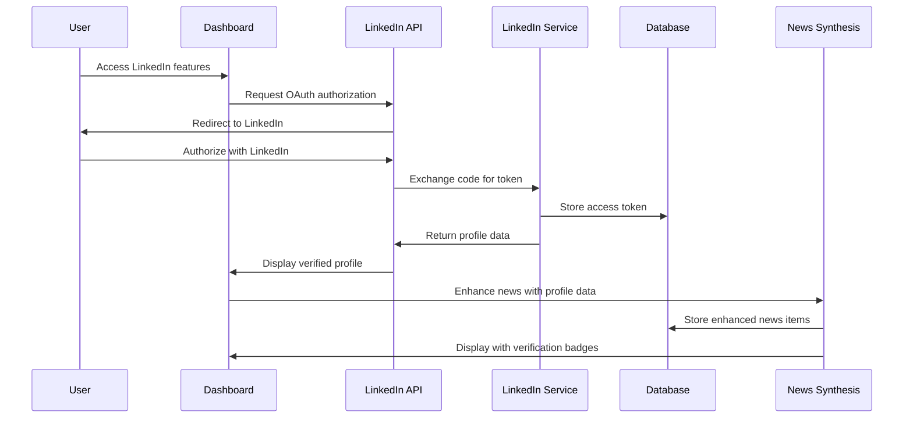
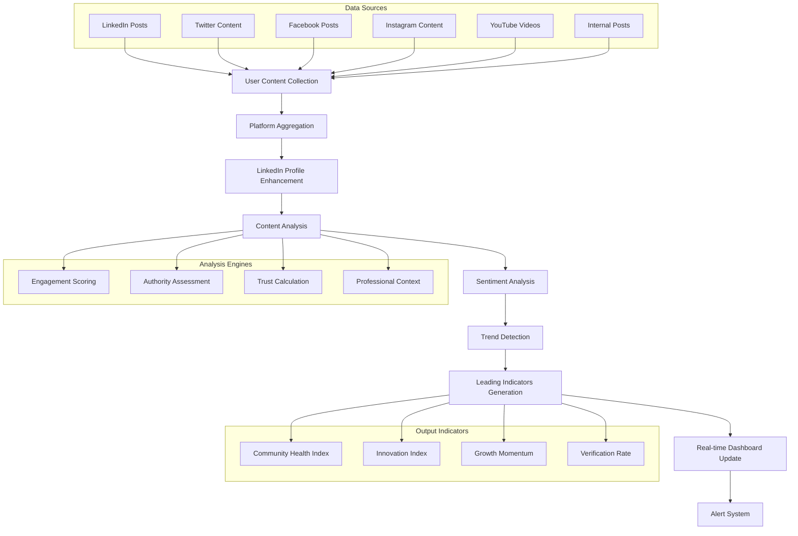
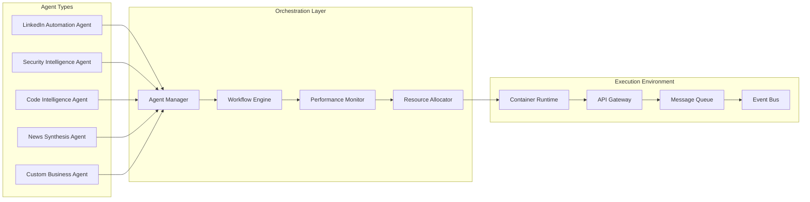
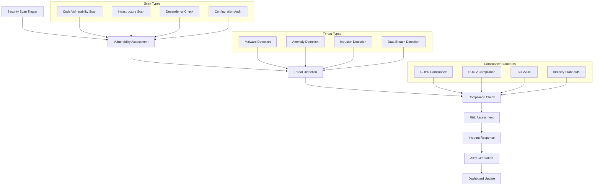
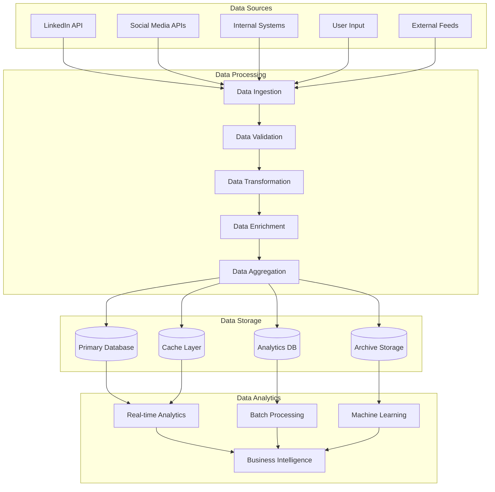
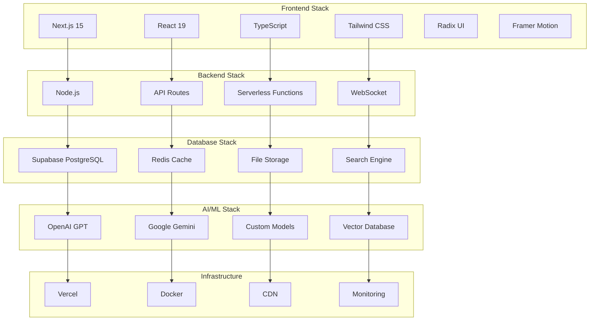
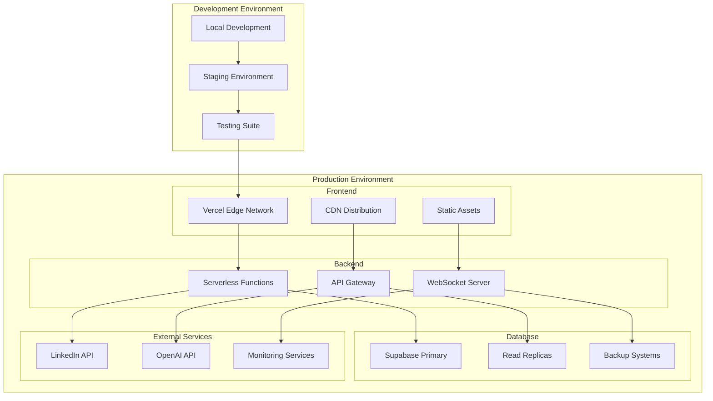

# AgentDash System Architecture - Mermaid Visualization

## Complete System Architecture Diagram

```mermaid
graph TB
    %% User Interface Layer
    subgraph "🎨 User Interface Layer"
        UI1[Main Dashboard]
        UI2[LinkedIn Command Center]
        UI3[Intelligent News Dashboard]
        UI4[Agent Orchestration]
        UI5[Code Intelligence]
        UI6[Security Intelligence]
        UI7[Alert System]
    end

    %% API Gateway Layer
    subgraph "🔌 API Gateway Layer"
        API1[LinkedIn Lite Profile API]
        API2[News Synthesis API]
        API3[Alert Management API]
        API4[Agent Management API]
        API5[Security Intelligence API]
    end

    %% Core Services Layer
    subgraph "⚙️ Core Services Layer"
        subgraph "LinkedIn Integration"
            LI1[LinkedIn Lite Profile Service]
            LI2[LinkedIn Verified Integration]
            LI3[OAuth 2.0 Authentication]
            LI4[Profile Enhancement Engine]
        end
        
        subgraph "Intelligent News Synthesis"
            NS1[News Collection Engine]
            NS2[Content Analysis Engine]
            NS3[Sentiment Analysis]
            NS4[Trend Detection]
            NS5[Leading Indicators Generator]
        end
        
        subgraph "Agent Orchestration"
            AO1[Agent Manager]
            AO2[Workflow Engine]
            AO3[Performance Monitor]
            AO4[Custom Agent Builder]
        end
        
        subgraph "Security Intelligence"
            SI1[Vulnerability Scanner]
            SI2[Threat Detection]
            SI3[Compliance Tracker]
            SI4[Incident Response]
        end
    end

    %% Data Layer
    subgraph "💾 Data Layer"
        subgraph "Database"
            DB1[(Supabase PostgreSQL)]
            DB2[LinkedIn Profiles Cache]
            DB3[News Synthesis Cache]
            DB4[Alert Storage]
            DB5[Agent Configurations]
        end
        
        subgraph "External APIs"
            EXT1[LinkedIn Lite Profile API]
            EXT2[OpenAI GPT API]
            EXT3[Google Gemini API]
            EXT4[Social Media APIs]
        end
    end

    %% Real-time Layer
    subgraph "⚡ Real-time Layer"
        RT1[WebSocket Connections]
        RT2[Live Updates]
        RT3[Alert Notifications]
        RT4[Performance Monitoring]
    end

    %% Connections - UI to API
    UI1 --> API1
    UI1 --> API2
    UI1 --> API3
    UI2 --> API1
    UI3 --> API2
    UI3 --> API3
    UI4 --> API4
    UI5 --> API5
    UI6 --> API5
    UI7 --> API3

    %% Connections - API to Services
    API1 --> LI1
    API1 --> LI2
    API2 --> NS1
    API2 --> NS2
    API3 --> NS5
    API4 --> AO1
    API5 --> SI1

    %% Connections - Services to Data
    LI1 --> EXT1
    LI2 --> DB2
    NS1 --> DB1
    NS2 --> DB3
    NS3 --> DB1
    NS4 --> DB1
    NS5 --> DB4
    AO1 --> DB5
    SI1 --> DB1

    %% Connections - Real-time
    RT1 --> UI1
    RT1 --> UI3
    RT1 --> UI7
    RT2 --> NS1
    RT3 --> NS5
    RT4 --> AO3

    %% Styling
    classDef uiClass fill:#e1f5fe,stroke:#01579b,stroke-width:2px
    classDef apiClass fill:#f3e5f5,stroke:#4a148c,stroke-width:2px
    classDef serviceClass fill:#e8f5e8,stroke:#1b5e20,stroke-width:2px
    classDef dataClass fill:#fff3e0,stroke:#e65100,stroke-width:2px
    classDef realtimeClass fill:#fce4ec,stroke:#880e4f,stroke-width:2px

    class UI1,UI2,UI3,UI4,UI5,UI6,UI7 uiClass
    class API1,API2,API3,API4,API5 apiClass
    class LI1,LI2,LI3,LI4,NS1,NS2,NS3,NS4,NS5,AO1,AO2,AO3,AO4,SI1,SI2,SI3,SI4 serviceClass
    class DB1,DB2,DB3,DB4,DB5,EXT1,EXT2,EXT3,EXT4 dataClass
    class RT1,RT2,RT3,RT4 realtimeClass
```

## LinkedIn Integration Flow

## Intelligent News Synthesis Flow

## Agent Orchestration Architecture

## Security Intelligence Flow

## Data Flow Architecture

## Technology Stack Visualization

## Deployment Architecture

---

## How to Use These Diagrams

1. **Copy the Mermaid code** from any section above
2. **Go to [Mermaid Live Editor](https://mermaid.live/)**
3. **Paste the code** into the editor
4. **View the interactive diagram** with zoom, pan, and export options
5. **Export as PNG, SVG, or PDF** for presentations

## Key Features Visualized

- **Complete System Architecture** with all layers and components
- **LinkedIn Integration Flow** showing OAuth and data enhancement
- **Intelligent News Synthesis** from collection to leading indicators
- **Agent Orchestration** with workflow management
- **Security Intelligence** with threat detection and compliance
- **Data Flow** from sources to analytics
- **Technology Stack** with all frameworks and services
- **Deployment Architecture** for production and development

These diagrams provide a comprehensive visual representation of the AgentDash system, making it easy to understand the architecture, data flow, and integration points for stakeholders and developers.
