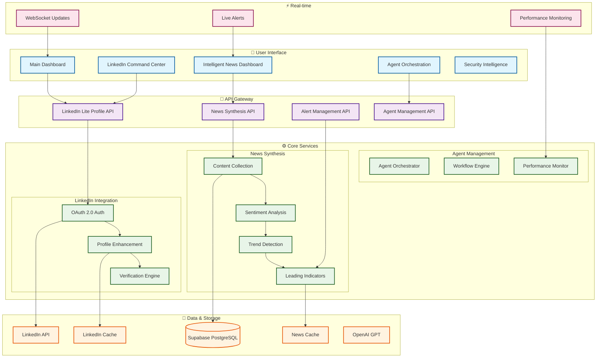
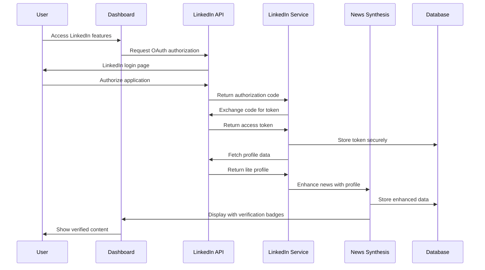
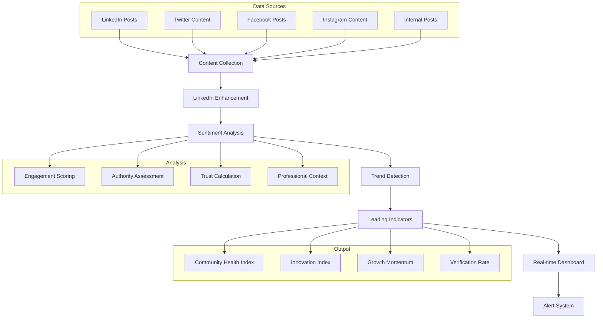
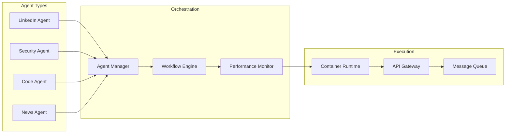
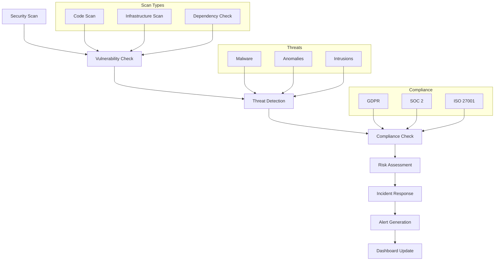
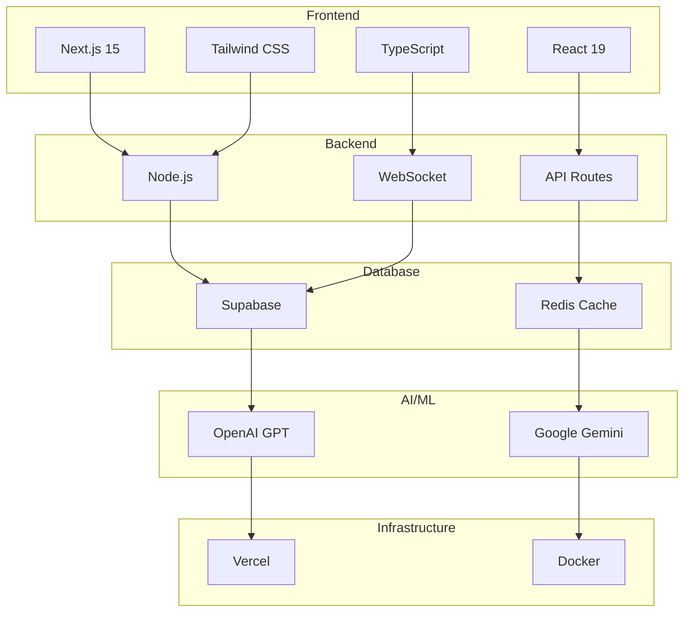
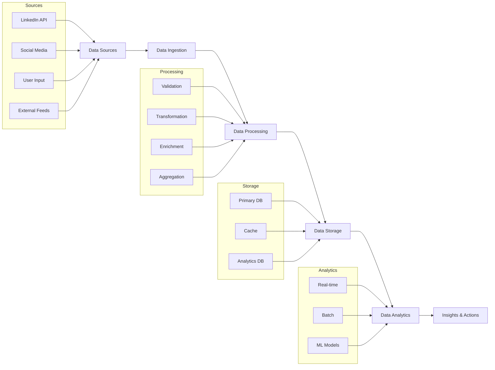

# AgentDash System Architecture - Mermaid Live Visualization

## 🎯 Main System Architecture

Copy and paste this code into [Mermaid Live Editor](https://mermaid.live/):

## 🔗 LinkedIn Integration Flow

## 📊 Intelligent News Synthesis Flow

## 🤖 Agent Orchestration

## 🛡️ Security Intelligence

## 🚀 Technology Stack

## 📈 Data Flow

---

## 🎯 How to Use

1. **Copy any diagram code** from above
2. **Go to [Mermaid Live Editor](https://mermaid.live/)**
3. **Paste the code** into the editor
4. **View the interactive diagram**
5. **Export as PNG, SVG, or PDF**

## 🔑 Key Features

- **Complete System Architecture** with all components
- **LinkedIn Integration Flow** with OAuth and verification
- **Intelligent News Synthesis** from collection to insights
- **Agent Orchestration** with workflow management
- **Security Intelligence** with threat detection
- **Technology Stack** visualization
- **Data Flow** from sources to analytics

These diagrams provide a comprehensive visual representation of AgentDash's architecture and capabilities!
