# AgentDash Business Architecture - Multiple Graph Styles

## 🏢 Business Process Flow (Flowchart Style)

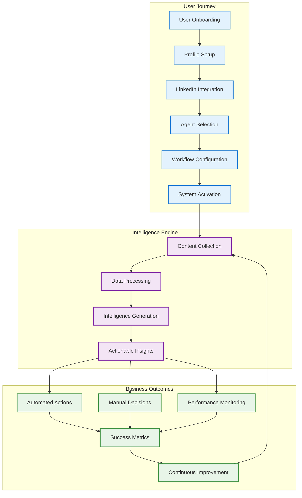

## 💼 Revenue Streams (Mind Map Style)

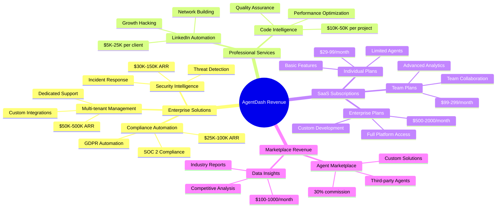

## 🎯 Customer Segments (Pie Chart Style)

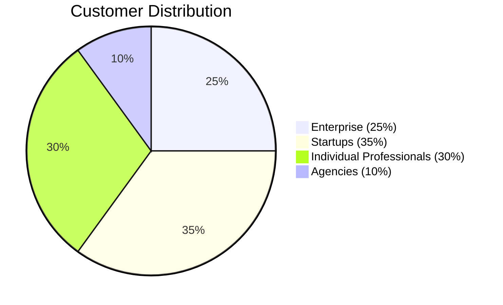

## 📊 Value Proposition Canvas (Quadrant Style)

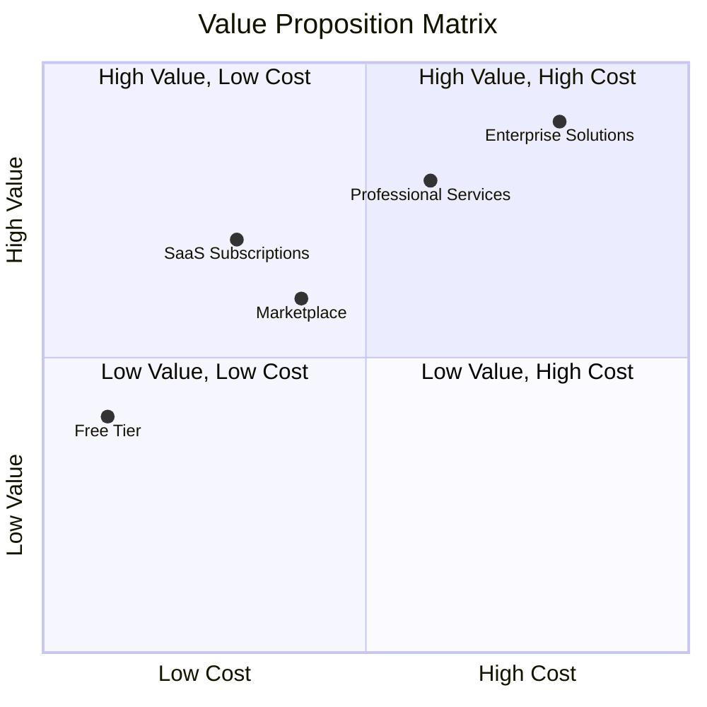

## 🔄 Business Model Canvas (Grid Style)

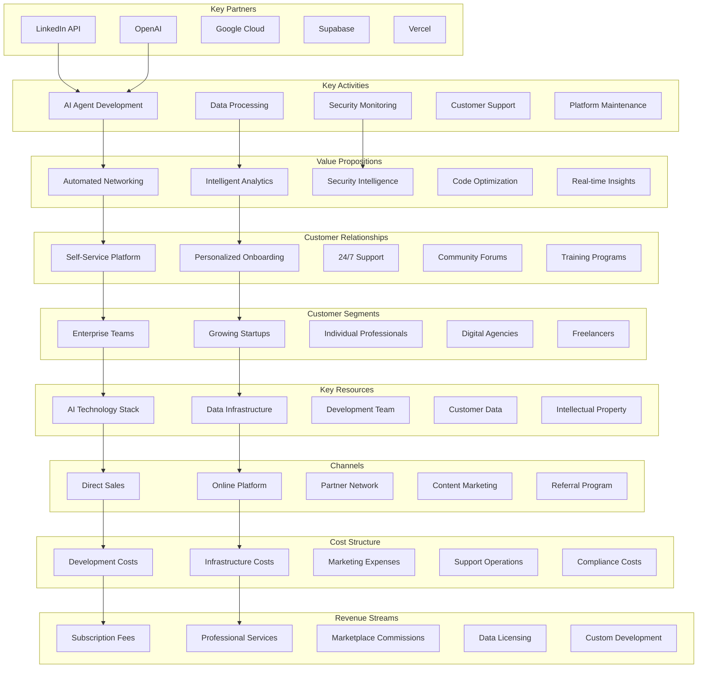

## 🚀 Go-to-Market Strategy (Timeline Style)

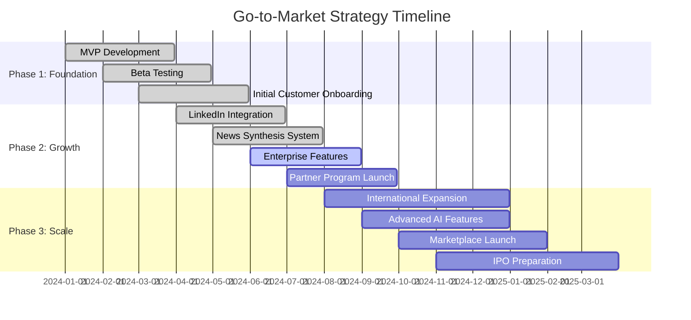

## 📈 Competitive Analysis (Radar Chart Style)

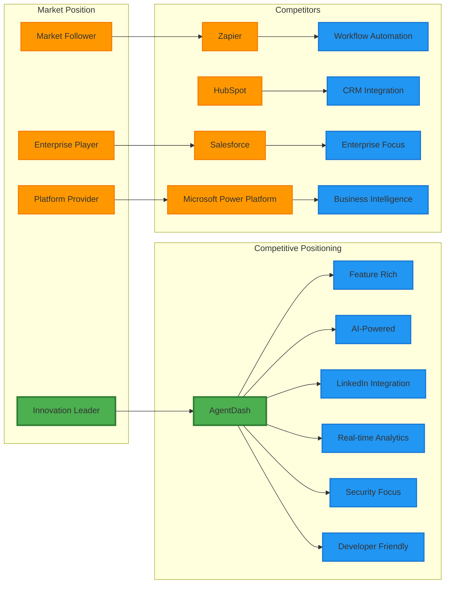

## 🎯 User Journey Map (Journey Style)

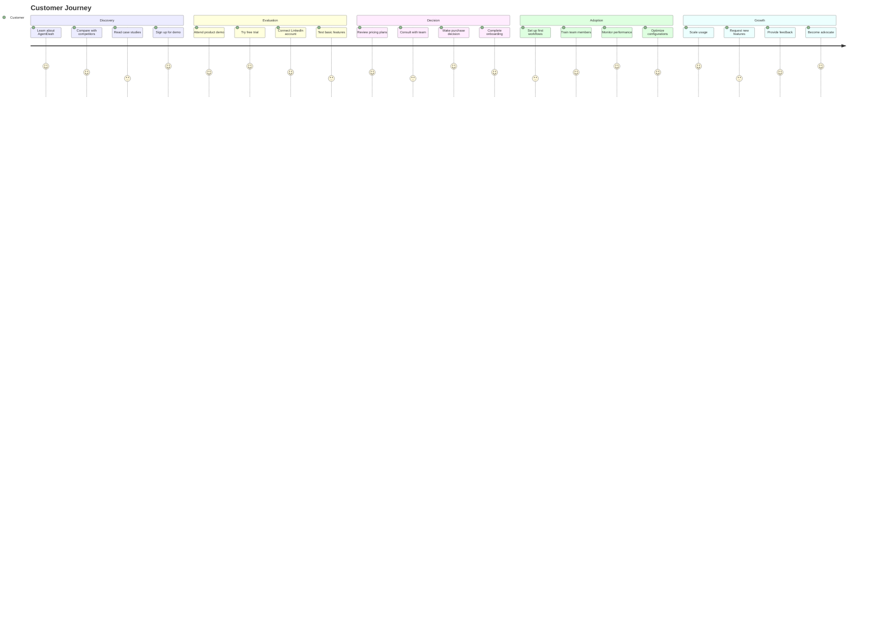

## 🏗️ Organizational Structure (Org Chart Style)

```mermaid
graph TD
    CEO[CEO - Brian] --> CTO[CTO - Technical Lead]
    CEO --> CMO[CMO - Marketing Lead]
    CEO --> CFO[CFO - Finance Lead]
    
    CTO --> ENG1[Engineering Team]
    CTO --> AI1[AI/ML Team]
    CTO --> SEC1[Security Team]
    
    ENG1 --> FE1[Frontend Developers]
    ENG1 --> BE1[Backend Developers]
    ENG1 --> DEVOPS1[DevOps Engineers]
    
    AI1 --> ML1[ML Engineers]
    AI1 --> DATA1[Data Scientists]
    AI1 --> NLP1[NLP Specialists]
    
    SEC1 --> SEC2[Security Engineers]
    SEC1 --> COMP1[Compliance Team]
    SEC1 --> AUDIT1[Audit Team]
    
    CMO --> MKT1[Marketing Team]
    CMO --> SALES1[Sales Team]
    CMO --> CS1[Customer Success]
    
    MKT1 --> CONTENT1[Content Marketing]
    MKT1 --> GROWTH1[Growth Marketing]
    MKT1 --> BRAND1[Brand Management]
    
    SALES1 --> ENTERPRISE1[Enterprise Sales]
    SALES1 --> SMB1[SMB Sales]
    SALES1 --> PARTNER1[Partner Sales]
    
    CS1 --> SUPPORT1[Customer Support]
    CS1 --> ONBOARD1[Onboarding Team]
    CS1 --> SUCCESS1[Success Managers]
    
    CFO --> FIN1[Finance Team]
    CFO --> LEGAL1[Legal Team]
    CFO --> HR1[HR Team]
    
    classDef executiveClass fill:#ff6b6b,stroke:#d63031,stroke-width:3px
    classDef techClass fill:#4ecdc4,stroke:#00b894,stroke-width:2px
    classDef businessClass fill:#45b7d1,stroke:#0984e3,stroke-width:2px
    classDef supportClass fill:#96ceb4,stroke:#00b894,stroke-width:2px
    
    class CEO,CTO,CMO,CFO executiveClass
    class ENG1,AI1,SEC1,FE1,BE1,DEVOPS1,ML1,DATA1,NLP1,SEC2,COMP1,AUDIT1 techClass
    class MKT1,SALES1,CS1,CONTENT1,GROWTH1,BRAND1,ENTERPRISE1,SMB1,PARTNER1 businessClass
    class SUPPORT1,ONBOARD1,SUCCESS1,FIN1,LEGAL1,HR1 supportClass
```

## 📊 Financial Projections (Bar Chart Style)

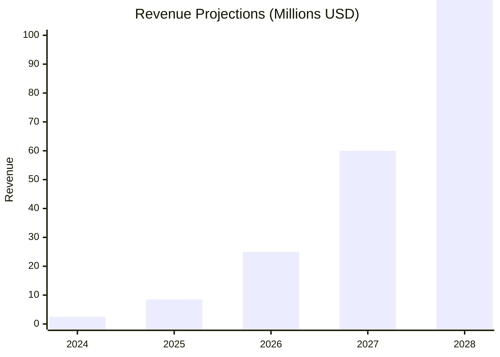

## 🔄 Product Development Lifecycle (State Diagram Style)

```mermaid
stateDiagram-v2
    [*] --> Idea
    Idea --> Research
    Research --> Prototype
    Prototype --> MVP
    MVP --> Beta
    Beta --> Production
    Production --> Growth
    Growth --> Maturity
    Maturity --> Innovation
    Innovation --> Research
    
    state Research {
        [*] --> MarketAnalysis
        MarketAnalysis --> UserResearch
        UserResearch --> CompetitiveAnalysis
        CompetitiveAnalysis --> [*]
    }
    
    state Prototype {
        [*] --> Design
        Design --> Development
        Development --> Testing
        Testing --> [*]
    }
    
    state MVP {
        [*] --> CoreFeatures
        CoreFeatures --> UserTesting
        UserTesting --> Feedback
        Feedback --> [*]
    }
    
    state Production {
        [*] --> Launch
        Launch --> Monitoring
        Monitoring --> Optimization
        Optimization --> [*]
    }
    
    state Growth {
        [*] --> Scaling
        Scaling --> FeatureExpansion
        FeatureExpansion --> MarketExpansion
        MarketExpansion --> [*]
    }
```

## 🎯 Strategic Priorities (Priority Matrix Style)

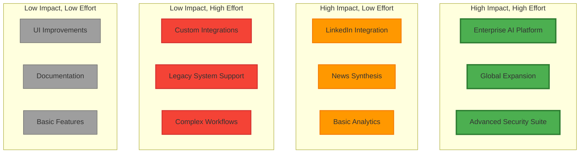

---

## 🎯 How to Use These Business Diagrams

1. **Copy any diagram code** from above
2. **Go to [Mermaid Live Editor](https://mermaid.live/)**
3. **Paste the code** into the editor
4. **View the interactive business diagram**
5. **Export as PNG, SVG, or PDF** for presentations

## 📊 Business Diagram Types

- **Flowchart**: Business process flows and user journeys
- **Mind Map**: Revenue streams and business model components
- **Pie Chart**: Customer segment distribution
- **Quadrant Chart**: Value proposition positioning
- **Grid Chart**: Business model canvas
- **Gantt Chart**: Go-to-market timeline
- **Radar Chart**: Competitive analysis
- **Journey Map**: Customer experience mapping
- **Org Chart**: Organizational structure
- **Bar Chart**: Financial projections
- **State Diagram**: Product development lifecycle
- **Priority Matrix**: Strategic planning

These diverse diagram styles provide comprehensive visual representations of all aspects of the AgentDash business!
