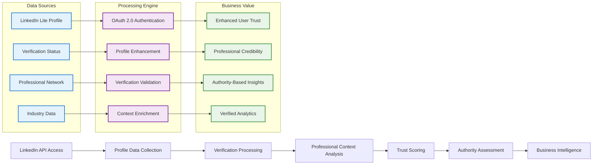
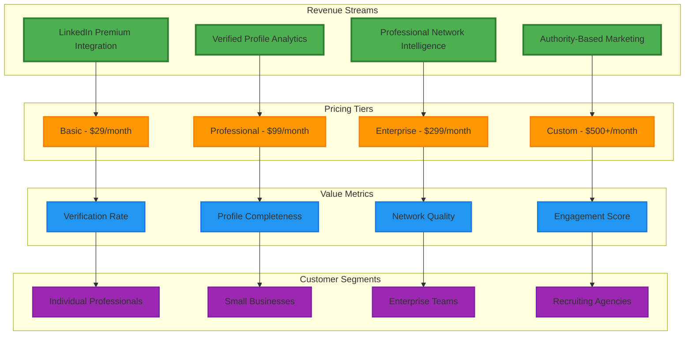
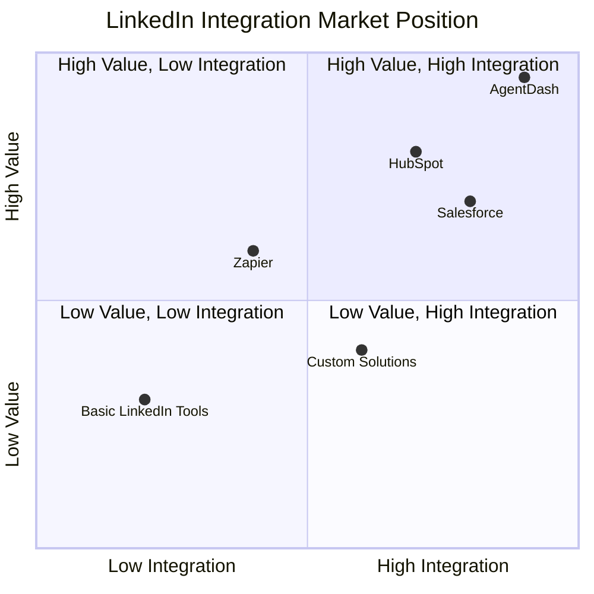
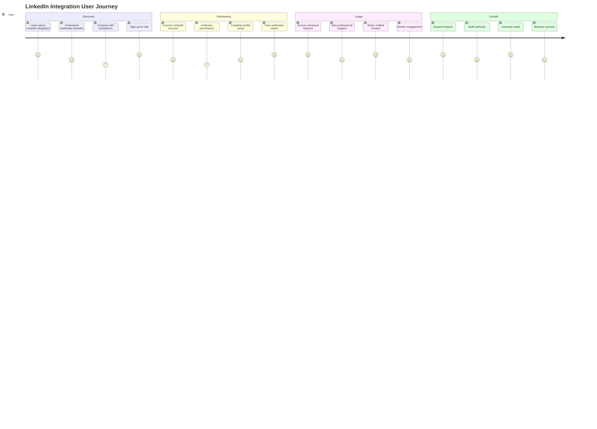
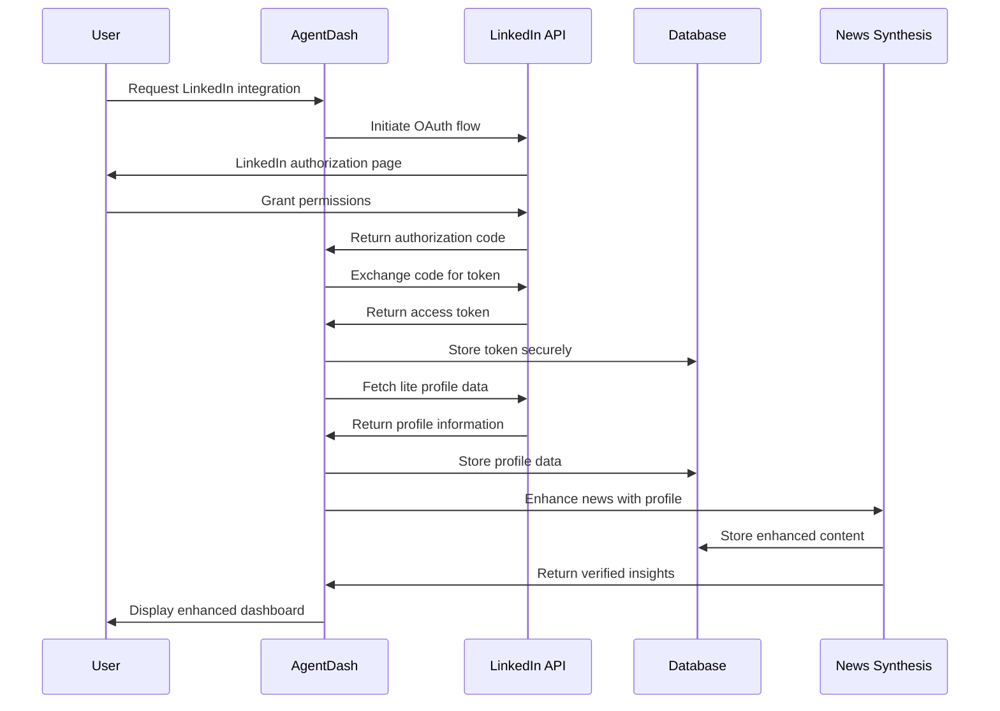
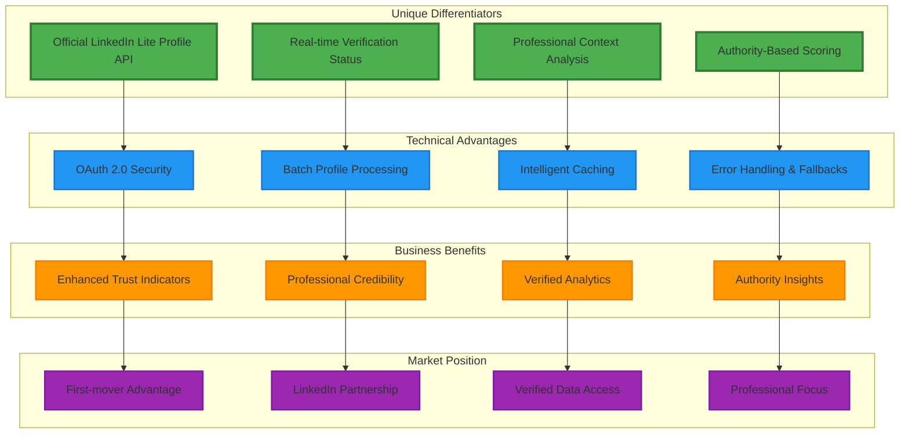
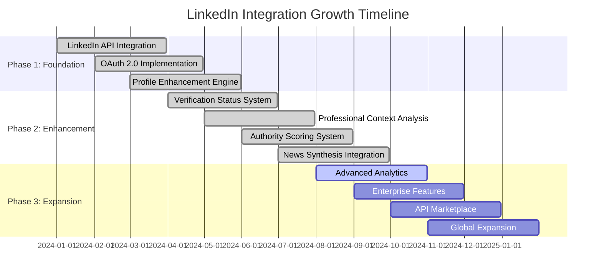
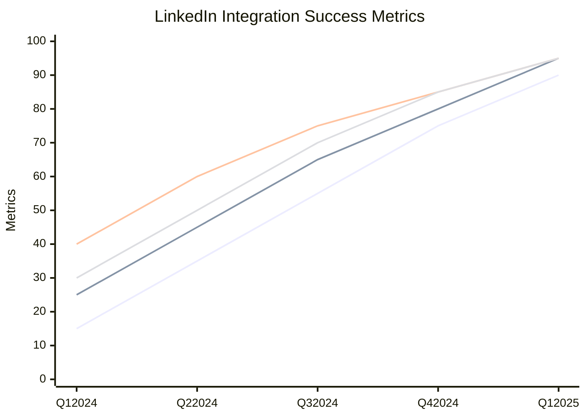
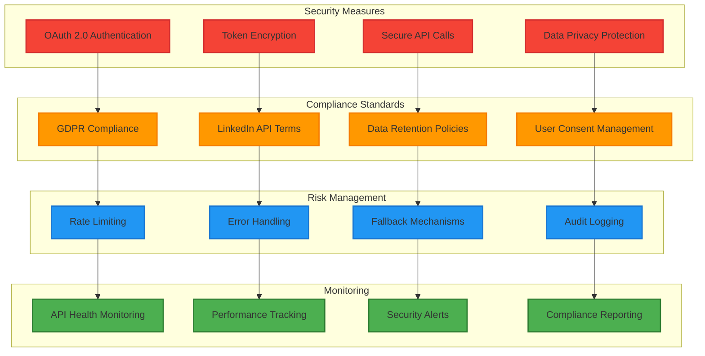

# LinkedIn Integration Business Model - Specialized Diagrams

## 🔗 LinkedIn Integration Value Chain

## 💼 LinkedIn Revenue Model

## 🎯 LinkedIn Market Positioning

## 📊 LinkedIn User Journey

## 🔄 LinkedIn Data Flow

## 🏆 LinkedIn Competitive Advantage

## 📈 LinkedIn Growth Strategy

## 🎯 LinkedIn Success Metrics

## 🔐 LinkedIn Security & Compliance

---

## 🎯 How to Use LinkedIn Business Diagrams

1. **Copy any diagram code** from above
2. **Go to [Mermaid Live Editor](https://mermaid.live/)**
3. **Paste the code** into the editor
4. **View the interactive LinkedIn business diagram**
5. **Export as PNG, SVG, or PDF** for presentations

## 📊 LinkedIn Business Diagram Types

- **Flowchart**: LinkedIn integration value chain
- **Graph**: Revenue model and competitive advantage
- **Quadrant Chart**: Market positioning
- **Journey Map**: User experience flow
- **Sequence Diagram**: Technical data flow
- **Gantt Chart**: Growth strategy timeline
- **Line Chart**: Success metrics tracking
- **Security Diagram**: Compliance and risk management

These specialized diagrams focus specifically on the LinkedIn integration business model and its strategic value!
